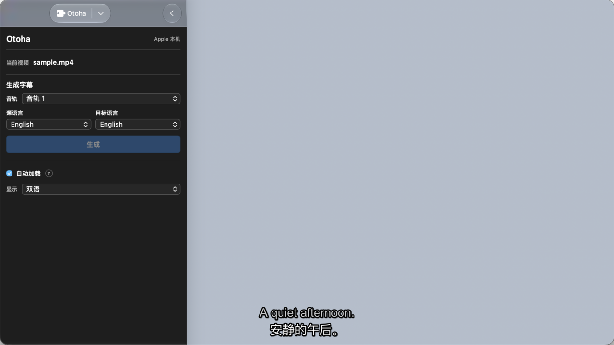

<p align="center">
  
</p>

<h1 align="center">Otoha</h1>

<p><strong>面向 IINA 的本机双语字幕转录与翻译插件</strong></p>

<p>选择音轨和语言，后台生成 ASS 字幕，并自动加载到播放器。</p>

<p><a href="#安装">安装</a> · <a href="#使用">使用</a> · <a href="#开发">开发</a> · <a href="#文档">文档</a></p>

> 目标平台：Apple Silicon Mac / macOS 26.4+。截图使用本地合成画面，不包含私人媒体。

## 项目概览

| 项目 | 当前版本 |
| --- | --- |
| 运行环境 | macOS 26.4+ / Apple Silicon |
| IINA 集成 | Sidebar 插件 + 随包 Swift helper |
| 转录与翻译 | Apple 本机 Speech / Translation |
| 媒体处理 | 用户提供的 FFmpeg / FFprobe |
| 字幕格式 | ASS，源文 + 译文 |
| 许可证 | [MIT](LICENSE) |

## 功能

- 对本地视频的一个音轨执行后台转录和翻译。
- 输出源文在上、译文在下的双语 ASS；默认源文 42px、译文 54px，源文较淡，白字配黑色描边和轻阴影。
- 在侧栏切换“原文 / 译文 / 双语”，显示方式按视频记忆，默认双语。
- 开启“自动加载”后，打开视频会加载字幕库中的已有 ASS。
- 同一视频和语言对重新生成时覆盖对应文件，其他语言版本保留。
- helper 已包含在插件包内，不需要单独安装或启动。

处理过程只在本机运行：Otoha 不提供云端上传路径，视频、音频和字幕保留在本机。

## 快速导航

- [安装](#安装)：Release 包和源码开发包两种方式。
- [使用](#使用)：从打开视频到加载字幕的完整流程。
- [文件位置](#文件位置)：默认字幕库和自定义目录。
- [界面截图](#界面截图)：查看侧栏和双语字幕的合成画面。
- [开发](#开发)：测试、打包和本地链接。
- [文档](#文档)：架构、协议、排障和发布说明。

## 安装

### 前置条件

1. 已安装 IINA。
2. Apple Silicon Mac，macOS 26.4 或更新版本。
3. 已安装 FFmpeg 和 FFprobe。推荐使用 Homebrew：

   ```bash
   brew install ffmpeg
   ```

### 从 Release 安装

在 [GitHub Releases](https://github.com/BBboy01/otoha/releases) 下载匹配版本的 `Otoha-<版本>-macos-arm64.iinaplgz`，用 IINA 打开，或在 IINA 的 Plugins 设置中安装。仓库不保证每个提交都有 Release，请以 Releases 页面为准。

### 从源码安装

```bash
git clone https://github.com/BBboy01/otoha.git
cd otoha
package_dir="$(mktemp -d)/Otoha.iinaplugin"
bash scripts/package-plugin.sh "$package_dir"
bash scripts/verify-plugin-package.sh "$package_dir"
/Applications/IINA.app/Contents/MacOS/iina-plugin link "$package_dir"
```

重新安装开发包前，先对旧目录执行同一 CLI 的 `unlink`，确保 IINA 中只保留一个 `io.otoha.iina`。打开 IINA 后，在 Plugins 菜单显示 Otoha 侧栏。插件包包含 `OtohaHelper.app`，不需要再安装单独的 helper。

IINA 官方插件流程：[Creating Plugins](https://docs.iina.io/pages/creating-plugins.html) · [Developer Guide](https://docs.iina.io/pages/dev-guide.html)。

## 使用

1. 在 IINA 打开一个本地视频。
2. 打开 Otoha 侧栏，确认要处理的音轨。
3. 选择源语言和目标语言，点击“生成”。
4. 等待检查环境、提取音轨、转录、翻译、保存和加载完成。
5. 用“显示”下拉框选择原文、译文或双语；该选择只作用于当前视频。

### 自动加载

“自动加载”只负责加载已经存在的字幕，不会在没有字幕时猜测源语言并自动转录。源语言和目标语言仍需要在侧栏或设置中明确配置。

### 全局设置

在 IINA 的 Otoha Preferences 中配置：

- 默认源语言和目标语言。
- FFmpeg 可执行文件绝对路径；留空时从 `PATH` 查找。
- 字幕库根目录。
- 自动加载。
- 字幕字号比例（默认 100%，可调范围 80%–140%；对应默认源文 42px、译文 54px）。

### 字幕样式

生成的 ASS 以 1920×1080 为基准：源文显示在上方，译文显示在下方。译文使用不透明白字，源文使用约 31% 透明度的白字；两者都使用黑色描边（3.5）和轻阴影（1.5），以便在浅色和深色画面上保持可读性。字号比例只影响字号，不改变字幕顺序和时间轴。

## 文件位置

默认字幕库：

```text
~/Library/Application Support/Otoha/Subtitles/
```

每个视频使用媒体路径的哈希目录隔离，字幕文件名包含源语言和目标语言。可在设置中改为自定义绝对路径或 `~/...` 路径；侧栏的“在 Finder 中显示”会定位所选字幕文件。

## 界面截图



*截图使用本地生成的纯色测试画面和合成字幕，仅用于展示侧栏、双语字幕和显示方式。*

## 开发

### 常用检查

```bash
npm test --prefix plugin
swift test --package-path helper
git diff --check
```

### 打包并验证

```bash
package_dir="$(mktemp -d)/Otoha.iinaplugin"
bash scripts/package-plugin.sh "$package_dir"
bash scripts/verify-plugin-package.sh "$package_dir"
```

打包脚本会构建 Swift helper，按 `scripts/plugin-files.txt` 复制插件资源，并记录 helper 源码哈希、二进制哈希和架构证据。验证脚本会检查资源白名单、helper bundle 元数据、arm64 Mach-O、二进制哈希和源码清单。

只在 macOS 26.4+ 上构建 Swift helper。不要提交 `dist/`、个人媒体、字幕、日志、`.env` 或 `helper/.build`。

## 边界与验收

- 只处理本地文件视频，一次处理一个用户选择的音轨。
- 只提供 Apple 本机后端；不包含云端服务、实时字幕、字幕网站搜索、批量队列或字幕编辑器。
- 当前包校验目标是 arm64；没有 Universal 或 Intel 兼容承诺。
- 首次使用 Apple 语音或翻译资源时，macOS 可能显示系统权限或资源准备提示。
- 自动加载、真实 IINA 字幕轨道确认、Apple 语言资源准备和正式 tag Release 仍需在目标 Mac 上做最终验收。

## 文档

### 产品与架构

- [文档索引](docs/README.md)
- [产品与技术决策](docs/iina-transcription-translation-plugin-plan.md)
- [架构说明](docs/architecture.md)
- [运行时状态与 protocol v1](docs/runtime-state-and-protocol-v1.md)

### 开发与运维

- [开发指南](docs/development.md)
- [排障指南](docs/troubleshooting.md)
- [发布指南](docs/release.md)
