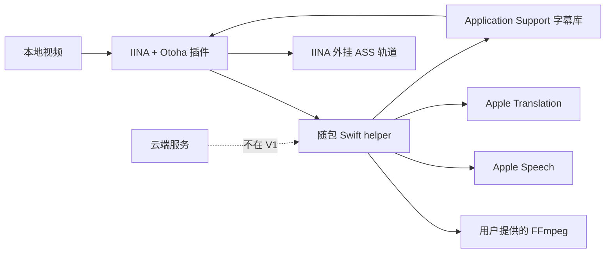

# Otoha 文档

这里的文档以当前仓库代码、测试和打包脚本为准。涉及真实 IINA 界面、Apple 语言资源或正式发布的内容，会明确标出“待实机验收”，不把静态测试结果当成完整产品验收。

## 从哪里开始

| 目标 | 文档 |
| --- | --- |
| 安装和第一次使用 | [根 README](../README.md) |
| 理解模块、进程和数据流 | [架构说明](architecture.md) |
| 理解产品边界和已确认决策 | [产品与技术决策](iina-transcription-translation-plugin-plan.md) |
| 接入插件与 helper 的 JSONL | [运行时状态与 protocol v1](runtime-state-and-protocol-v1.md) |
| 本地开发、测试和新增功能 | [开发指南](development.md) |
| 查找安装、FFmpeg、重复插件等问题 | [排障指南](troubleshooting.md) |
| 打包、tag 和 GitHub Release | [发布指南](release.md) |

## 关键边界

Otoha 不上传视频或音频；FFmpeg 不是插件资产，而是用户环境中的共享依赖。helper 由插件包携带，正常任务以后台模式运行。

## 证据分级

- **代码已实现：** Node/Swift 单元测试覆盖的状态、协议、文件名、字幕库、取消和打包校验行为。
- **构建已验证：** macOS CI 构建出的 arm64 helper、插件包和发布归档可通过 verifier。
- **待实机验收：** 真实 IINA 字幕轨道确认、Apple 语音/翻译资源首次准备、系统权限提示、VoiceOver/深色模式和正式 Release 安装。
