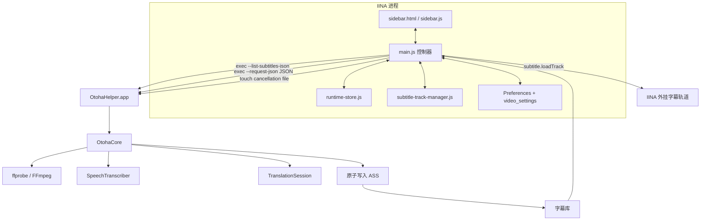
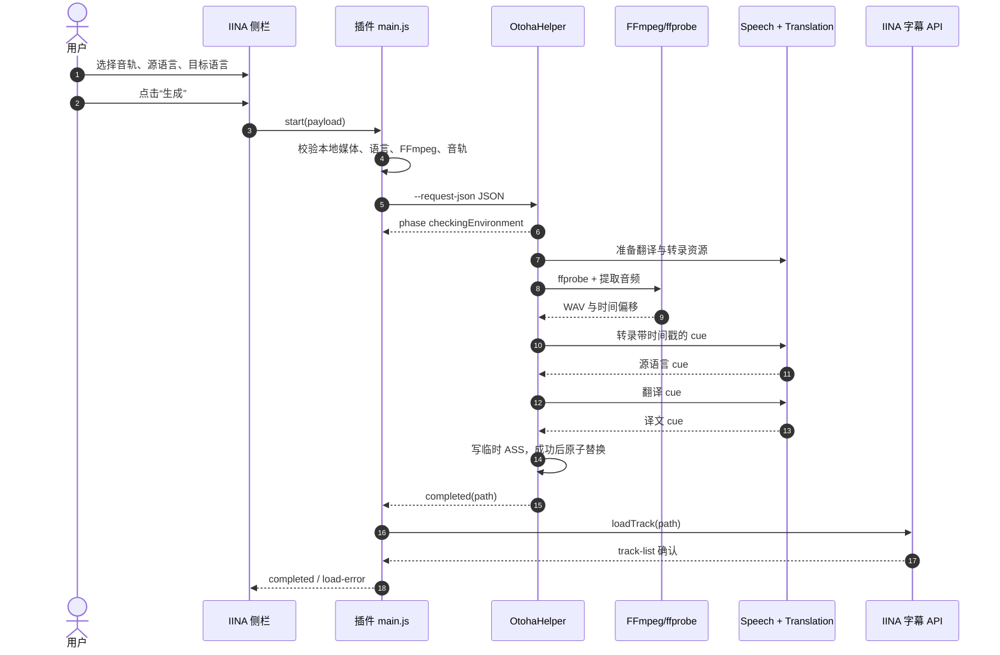

# 架构说明

Otoha 把 UI 编排、媒体解码、Apple 语言能力和字幕加载拆开。IINA 侧栏只管理用户意图和可重放状态；长任务在随包 helper 中执行；FFmpeg 和 Apple 框架都留在本机。

## 组件关系



### 边界与责任

| 模块 | 责任 | 不负责什么 |
| --- | --- | --- |
| `plugin/main.js` | 生命周期、当前媒体、启动/取消 helper、处理事件、加载字幕 | 读取音频帧、调用 Apple 语言 API |
| `plugin/runtime-store.js` | 保存完整 `AppState` 快照，过滤过期异步结果 | 直接渲染 HTML |
| `plugin/sidebar.js` | 渲染状态、发送用户操作、无障碍属性 | 推断任务真相 |
| `plugin/subtitle-library-client.js` | 调用 helper 列出当前视频字幕，自动加载已有文件 | 生成字幕内容 |
| `plugin/subtitle-track-manager.js` | 加载 ASS、按显示模式生成 IINA 内存缓存、移除旧轨道 | 修改源 ASS 文件 |
| `OtohaHelper` | 后台入口、JSONL 输出、系统版本检查、任务生命周期 | 保存插件偏好 |
| `OtohaCore` | FFmpeg 配置、取消、转录/翻译流水线、ASS 原子发布 | 访问 IINA API |
| 用户 FFmpeg | 读取视频并提取选定的 FFmpeg stream index | 转录或翻译 |

## 生成字幕时序



## 自动加载与并发

自动加载是字幕库读取策略，不是自动转录策略。打开文件后，插件通过 helper 的 `--list-subtitles-json` 查询当前视频目录；只有 `auto_load=true` 且列表非空时才调用加载。源语言和目标语言仍由侧栏或每视频记忆提供。

媒体切换、字幕库刷新、显示模式转换和任务启动各自拥有 operation token。提交异步结果前必须同时匹配当前媒体路径、媒体操作和任务 ID；过期结果直接丢弃。新视频到来时，插件先写取消标记，helper 终止语言任务并清理临时目录，不发布半成品。

## 文件和进程

```text
IINA plugin process
├── plugin/*.js, sidebar.html, preferences.html
└── @tmp/otoha-<jobId>.cancel          # 取消标记

Plugin package
└── bin/OtohaHelper.app/Contents/MacOS/otoha-helper

Application Support
└── Otoha/Subtitles/<media-name>-<sha256-prefix>/*.ass
```

helper 的后台模式设置 `NSApplicationActivationPolicy.prohibited`，正常任务不创建可见窗口；仅传入 `--ui` 或调试 bundle 环境变量时才启用调试窗口。首次 Apple 资源准备仍可能触发 macOS 自己的权限或下载提示。

## 安全和可靠性边界

- 请求中的媒体、FFmpeg、取消文件和输出路径必须是绝对路径；helper 会在写入前校验语言、音轨、目录和字号范围。
- ASS 先写临时文件，流水线成功后再替换目标文件；取消、转录失败、翻译不完整不会发布最终文件。
- 包 verifier 使用资源白名单、helper bundle 元数据、二进制 SHA-256、源码清单和 arm64 Mach-O 检查，避免把未列出的资源或被替换的 helper 打进包。
- IINA 插件权限、macOS 文件权限和 FFmpeg 本地安装仍由运行环境提供；插件不绕过系统权限。
