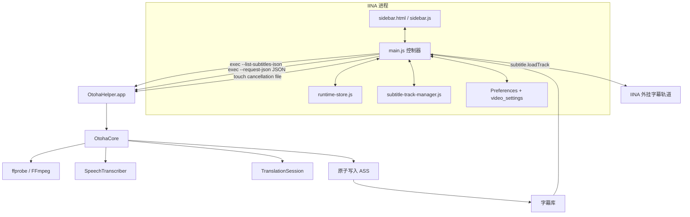
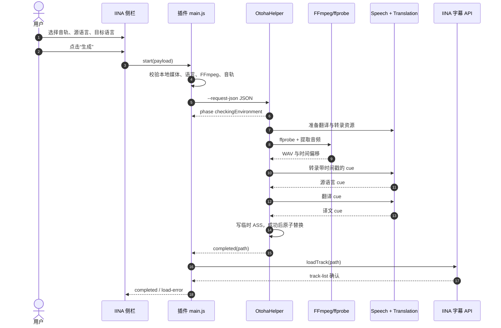

# 架构说明

Otoha 把 UI 编排、媒体解码、Apple 语言能力和字幕加载拆开。IINA 侧栏只管理用户意图和可重放状态；长任务在随包 helper 中执行；FFmpeg 和 Apple 框架都留在本机。

## 组件关系



### 边界与责任

| 模块 | 责任 | 不负责什么 |
| --- | --- | --- |
| `plugin/main.js` | 生命周期、当前媒体、启动/取消 helper、处理事件、加载字幕 | 读取音频帧、调用 Apple 语言 API |
| `plugin/runtime-store.js` | 保存完整 `AppState` 快照，过滤过期异步结果 | 直接渲染 HTML |
| `plugin/sidebar.js` | 渲染状态、发送用户操作、无障碍属性 | 推断任务真相 |
| `plugin/subtitle-library-client.js` | 调用 helper 列出当前视频字幕，自动加载已有文件 | 生成字幕内容 |
| `plugin/subtitle-deletion-controller.js` | 确认单个文件删除并验证 helper 响应 | 直接操作文件系统 |
| `plugin/subtitle-track-manager.js` | 加载 ASS、按显示模式生成 IINA 内存缓存、移除旧轨道 | 修改源 ASS 文件 |
| `plugin/subtitle-editor-controller.js` | 隔离校对会话、helper 请求和保存后刷新 | 保存草稿、改变时间或语言记忆 |
| `plugin/subtitle-editor.js` | 片段导航、原文/译文草稿、未保存确认和焦点恢复 | 写入字幕文件 |
| `OtohaHelper` | 后台入口、JSONL 输出、系统版本检查、任务生命周期 | 保存插件偏好 |
| `OtohaCore` | FFmpeg 配置、取消、转录/翻译流水线、ASS 原子发布 | 访问 IINA API |
| 用户 FFmpeg | 读取视频并提取选定的 FFmpeg stream index | 转录或翻译 |

侧栏状态中的 `jobActive` 表示主进程仍持有任务。Helper 的终止事件可先于进程退出到达；此时显示终止结果，但生成及字幕操作仍保持禁用，直到任务清理完成后的状态更新。取消控件失效时焦点暂留状态文本，任务释放后返回生成按钮。

## 生成字幕时序



## 自动加载

自动加载统一在 Otoha 全局设置的“播放”中配置，侧栏不提供重复开关。打开视频后，插件调用 helper 的 `--list-subtitles-json` 查询字幕库。只有自动加载开启且列表非空时，插件才加载字幕；生成仍由用户手动触发。用户侧行为见 [README](../README.md#使用)。

ASS 是字幕库中的规范文件；SRT 导出副本统一写入字幕库根目录下的 `Exports` 子目录，支持原文、译文或双语文本，不污染视频目录。导出保留时间轴，只承诺字幕文本与时间，不保留 ASS 样式；重名文件使用编号副本，避免覆盖用户文件。导出完成后可从侧栏在 Finder 中定位文件。IINA 1.5.0 的 `utils.chooseFile` 在取消时不结束 Promise，因此不使用其原生目录面板。

## 异步任务与取消

语言选择触发 `language-preflight-client.js` 调用 helper `--check-languages-json`，结果按媒体、语言对和请求序号隔离。Swift 通过 `SpeechTranscriber.supportedLocale`、`AssetInventory.status` 和高保真 `LanguageAvailability` 读取本机能力；Speech 预检和实际准备共享同一 transcriber 创建逻辑。预检不读取媒体或创建输出目录。`SubtitleJobRunner` 在所有准备和提取工作前复查能力，并在成功保存时才创建输出目录；无法使用的语言对不会启动长任务或改动旧字幕。

媒体切换、字幕库刷新、显示模式转换和任务启动各自使用 operation token。插件提交异步结果前会核对媒体路径、操作 token 和任务 ID，过期结果直接丢弃。切换到新视频时，插件写入取消标记，helper 终止当前任务并清理临时目录，不发布半成品。

`job-controller.js` 同时拥有任务的开始与结束时间；`runtime-store.js` 保存带时间戳的任务快照，侧栏只负责格式化耗时。helper 没有可靠百分比的阶段保持不确定进度。取消请求后不再接受阶段更新，避免迟到事件覆盖取消提示。

## 文件和进程

```text
IINA plugin process
├── plugin/*.js, sidebar.html, preferences.html
└── @tmp/otoha-<jobId>.cancel          # 取消标记

Plugin package
└── bin/OtohaHelper.app/Contents/MacOS/otoha-helper

Application Support
└── Otoha/Subtitles/<media-name>-<sha256-prefix>/*.ass
```

helper 的后台模式设置 `NSApplicationActivationPolicy.prohibited`，正常任务不创建可见窗口；仅传入 `--ui` 或调试 bundle 环境变量时才启用调试窗口。首次 Apple 资源准备仍可能触发 macOS 自己的权限或下载提示。

字幕校对通过独立读/写命令访问 `ASSEditStore`；它核对当前视频的字幕库路径与文件版本，`ASSEditDocument` 只替换原文/译文文本，`ASSOutput.replace` 原子发布。编辑会话存在期间暂停自动加载和新生成；草稿不进入共享运行状态。保存后刷新列表和当前显示轨道，失败时保留草稿或已保存文件。协议和限制见 [字幕校对](runtime-state-and-protocol-v1.md#7-字幕校对)。

## 安全和可靠性边界

- 请求中的媒体、FFmpeg、取消文件和输出路径必须是绝对路径；helper 会在写入前校验语言、音轨、目录和字号范围。
- ASS 先写临时文件，流水线成功后再替换目标文件；取消、转录失败、翻译不完整不会发布最终文件。
- 包 verifier 使用资源白名单、helper bundle 元数据、二进制 SHA-256、源码清单和 arm64 Mach-O 检查，避免把未列出的资源或被替换的 helper 打进包。
- IINA 插件权限、macOS 文件权限和 FFmpeg 本地安装仍由运行环境提供；插件不绕过系统权限。
