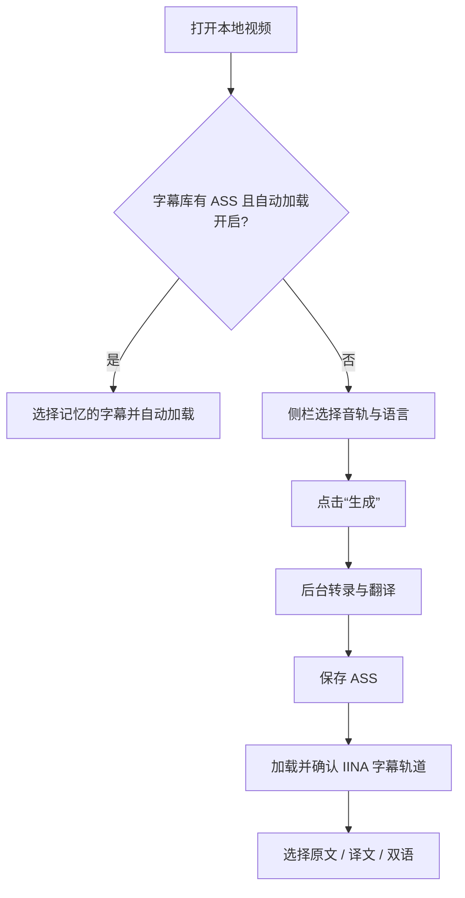
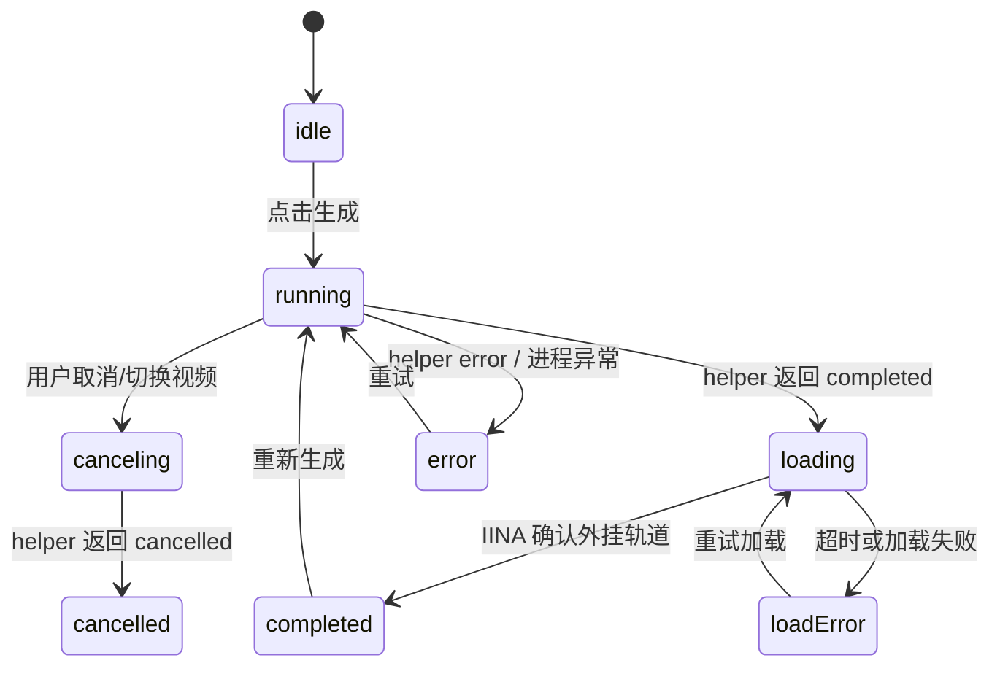

# Otoha 产品与技术决策

**状态：** V1 实现已落地，本文记录当前产品边界、用户体验和仍需实机验收的项目。协议字段见 [runtime-state-and-protocol-v1.md](runtime-state-and-protocol-v1.md)，代码结构见 [architecture.md](architecture.md)。

## 用户目标

用户在观看没有字幕的非母语视频时，可以在 IINA 侧栏选择音轨、明确源语言和目标语言，按一次“生成”，等待后台任务生成双语 ASS 并自动加载。用户也可以只显示原文、只显示译文或显示双语对照。

## 已确认决策

| 主题 | 决策 | 原因 |
| --- | --- | --- |
| 后端 | 首版只实现 Apple 本机 Speech + Translation；保留 backend 配置入口 | 保持本机隐私，同时为后续后端留边界 |
| helper | Swift helper 放在插件包内，用户只安装一次 | 不增加额外安装器和版本管理负担 |
| FFmpeg | 用户自行安装，插件从 PATH 查找，也允许配置绝对路径 | 让其他本机程序复用同一 FFmpeg |
| 触发方式 | 手动点击“生成”，后台执行 | 避免打开视频就消耗资源或误转录 |
| 自动加载 | 仅加载已有字幕，不在缺少字幕时猜语言和转录 | 源语言无法可靠自动判断，避免无声失败或错误语言 |
| 存储 | 默认 `~/Library/Application Support/Otoha/Subtitles`，每个视频哈希目录 | 对用户可见但不污染视频目录，且能保留多个语言版本 |
| 覆盖策略 | 同一媒体和语言对成功生成后覆盖；其他语言对保留 | 重生成结果可预测，历史选择不互相覆盖 |
| 显示方式 | 原文、译文、双语三选一，按视频记忆，默认双语 | 同一视频的学习/阅读需求通常稳定 |
| 输出 | ASS 以 1920×1080 为基准，源文在上、译文在下；默认源文 42px、译文 54px，源文约 31% 透明度，二者使用黑色描边和轻阴影 | 保持双语层级和跨画面可读性，同时支持单语显示缓存；字号比例可在 80%–140% 间调整 |
| 焦点 | helper 正常运行不激活窗口；只有系统级权限/资源提示可能打断 | 尽量不影响用户观看 |
| 兼容性 | 当前只验收 Apple Silicon + macOS 26.4+ | Apple Translation API 和打包校验以当前设备为目标 |

## UI/UX 结构

侧栏保持从当前视频到操作再到反馈的阅读顺序：

1. **当前视频**：单行省略，悬停显示完整名称。
2. **字幕列表**：存在字幕时显示下拉选择；已加载状态用标题后的图标表示；Finder 操作紧邻选择框。
3. **生成字幕**：音轨、源语言、目标语言集中在表单；主按钮只使用“生成”。
4. **任务反馈**：阶段和错误详情折叠，进度有可靠数值时才显示；失败保留重试和取消边界。
5. **播放选项**：自动加载和问号帮助图标；显示方式使用紧凑下拉框。

全局低频配置放在 Preferences：默认语言、FFmpeg 路径、字幕库根目录、自动加载和字号。侧栏只保留当前视频需要即时决定的控件。

## 任务状态

`running` 的细阶段由 `checkingEnvironment`、`preparingLanguageResources`、`extractingAudio`、`transcribing`、`translating`、`saving` 表示；完成后才进入 `loading`。媒体切换会取消旧任务，并通过 operation token 丢弃迟到事件。

## V1 明确不做

- 播放期间实时转录、批量任务、多音轨同时处理。
- 自动识别源语言、自动选择最佳音轨或从字幕网站下载字幕。
- 云端转录/翻译、字幕编辑器、同步到视频目录。
- 独立 helper 安装器、Intel/Universal 兼容包。

## 验收清单

### 已由自动化覆盖

- JavaScript 状态、协议解析、字幕显示模式、语言记忆和媒体切换。
- Swift 字幕流水线、取消/超时、FFmpeg 错误、ASS 原子发布和文件命名。
- 插件包资源白名单、helper 版本、源码/二进制哈希和 arm64 Mach-O。
- Release tag 版本匹配、归档上传和发布后重新校验。

### 仍需目标 Mac 实机确认

- Apple Speech/Translation 首次资源准备和系统权限提示。
- 多容器、多音轨下 `ff-index` 与实际音轨对应关系。
- IINA 加载 ASS 后 `track-list` 的确认时序和超时处理。
- 深色模式、VoiceOver、窄侧栏和长文件名的最终体验。

## 参考

- [IINA Creating Plugins](https://docs.iina.io/pages/creating-plugins.html)
- [IINA Developer Guide](https://docs.iina.io/pages/dev-guide.html)
- [Khuaplayer CaptionTranscriber](https://github.com/nake13/khuaplayer/blob/main/Modules/Captions/CaptionTranscriber.swift)
- [Khuaplayer CaptionTranslator](https://github.com/nake13/khuaplayer/blob/main/Apps/Mac/CaptionsHost/CaptionTranslator.swift)
- [Khuaplayer MediaCore audio reader](https://github.com/nake13/khuaplayer/blob/main/Modules/MediaCore/Bridge/SPCaptionAudioReader.mm)
