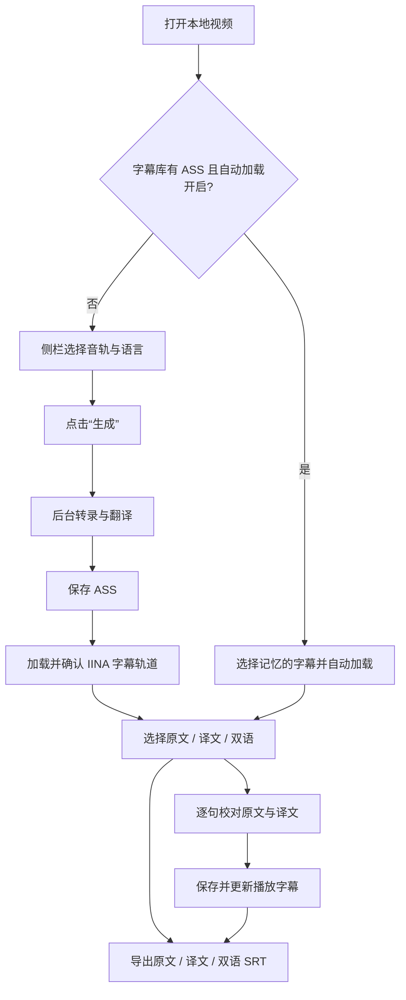
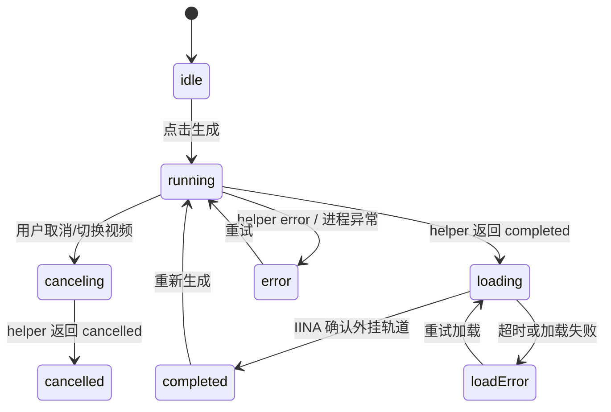

# Otoha 产品与技术决策

本文记录 Otoha 当前开发版本的产品目标、范围和已确认决策。真实 IINA 截图与操作视频见 [README 的界面预览](../README.md#界面预览)。组件实现见[架构说明](architecture.md)，插件与 helper 的字段契约见[运行时状态与 protocol v1](runtime-state-and-protocol-v1.md)。

## 用户目标

用户在观看没有字幕的非母语视频时，可以在 IINA 侧栏选择音轨、明确源语言和目标语言，点击“生成”，等待后台任务生成双语 ASS 并自动加载。用户可以选择原文、译文或双语显示，逐句校对后保存，也可以导出为 SRT。重新生成会创建新版本，保留原有字幕和人工校对。

## 已确认决策

| 主题 | 决策 | 原因 |
| --- | --- | --- |
| 后端 | 首版使用 Apple Speech + Translation；请求保留 backend 扩展点 | 使用系统框架，不维护自有语言模型服务 |
| helper | Swift helper 放在插件包内，用户只安装一次 | 不增加额外安装器和版本管理负担 |
| FFmpeg | 用户自行安装，插件从 PATH 查找，也允许配置绝对路径 | 让其他本机程序复用同一 FFmpeg |
| 触发方式 | 手动点击“生成”，后台执行 | 避免打开视频就消耗资源或误转录 |
| 自动加载 | 打开视频时只加载字幕库中的已有字幕，不自动转录 | 生成需要用户明确选择源语言，避免误用语言 |
| 存储 | 默认 `~/Library/Application Support/Otoha/Subtitles`，每个视频哈希目录 | 对用户可见但不污染视频目录，且能保留多个语言版本 |
| 版本策略 | 同一媒体和语言对重新生成时创建带编号的新版本，已有字幕保留 | 保留人工校对，可在语言对内切换字幕版本 |
| 显示方式 | 原文、译文、双语三选一，按视频记忆，默认双语 | 同一视频的学习/阅读需求通常稳定 |
| 校对 | 修改已有片段的原文和译文；保存全部或保存并下一句，保存失败保留草稿 | 让生成结果可以在观看时逐句修正 |
| 视频联动 | 默认开启，选择片段时定位视频；关闭后单击选中、双击定位 | 兼顾对照观看与连续编辑，避免每次选中都强制跳转 |
| 导出 | 选中的 ASS 可导出原文、译文或双语 SRT，保存到字幕库根目录的 `Exports` 子目录 | 便于在其他播放器或工具使用，重名时保留编号副本 |
| 输出 | ASS 逻辑高度为 1080，宽度按视频比例计算，左右各留 5% 边距；默认源文 38px、译文 34px，按实际字形宽度和语言边界换行；源文在上、译文在下，源文约 31% 透明度，配黑色描边和轻阴影 | 同一视频比例不因像素分辨率改变排版；支持单语显示缓存，字号比例可在 80% 至 140% 间调整 |
| 焦点 | helper 正常运行不激活窗口；只有系统级权限/资源提示可能打断 | 尽量不影响用户观看 |
| 兼容性 | 当前只验收 Apple Silicon + macOS 26.4+ | Apple Translation API 和打包校验以当前设备为目标 |

## 侧栏信息顺序

侧栏保持从当前视频到操作再到反馈的阅读顺序：

1. **当前视频**：Otoha 标识与视频名称；长名称省略，悬停显示完整名称。
2. **字幕**：语言对与字幕版本；标题右侧提供校对、导出和删除图标。文件详情与 Finder 定位入口位于导出弹窗内。
3. **显示**：原文、译文、双语三段切换，按视频记忆。
4. **生成**：音轨选择、自动加载开关、语言资源状态和生成按钮；有匹配字幕时按钮显示“重新生成”。
5. **任务反馈**：生成按钮保留，三个加载点表示进行中；反馈从按钮下方展开，完成后收回。进度有可靠数值时才显示，失败提供错误和重试入口。

校对页从右侧滑入，包含片段列表、当前索引、视频联动开关、原译文编辑框和保存区。列表在首尾禁用对应方向按钮；超长片段默认省略，悬停时循环滚动。未保存标记保留固定位置，避免内容偏移。

全局设置放在 Preferences，包括默认语言、FFmpeg 路径、字幕库根目录、自动加载和字号。侧栏集中展示当前视频、字幕版本、生成、校对和播放选项。深浅色、控件尺寸与动效沿用[共享主题变量](ui-theme.md)。

## 任务状态

此图描述用户可见的任务状态。helper 阶段、状态字段和错误码以 [protocol v1](runtime-state-and-protocol-v1.md) 为准。媒体切换会取消旧任务，并丢弃已过期的异步结果。

## 当前范围以外

- 播放期间实时转录、批量任务、多音轨同时处理。
- 自动识别源语言、自动选择最佳音轨或从字幕网站下载字幕。
- 云端转录/翻译、同步到视频目录。
- 校对中的时间轴调整、片段拆分合并；当前只修改已有片段的原文和译文。
- 独立 helper 安装器、Intel/Universal 兼容包。

自动化检查与人工验收范围见[开发指南](development.md#验证范围)。

## 参考

- [IINA Creating Plugins](https://docs.iina.io/pages/creating-plugins.html)
- [IINA Developer Guide](https://docs.iina.io/pages/dev-guide.html)
- [Khuaplayer CaptionTranscriber](https://github.com/nake13/khuaplayer/blob/main/Modules/Captions/CaptionTranscriber.swift)
- [Khuaplayer CaptionTranslator](https://github.com/nake13/khuaplayer/blob/main/Apps/Mac/CaptionsHost/CaptionTranslator.swift)
- [Khuaplayer MediaCore audio reader](https://github.com/nake13/khuaplayer/blob/main/Modules/MediaCore/Bridge/SPCaptionAudioReader.mm)
