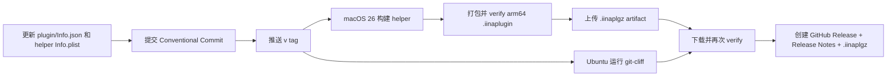

# 发布指南

发布由 GitHub Actions 负责。tag 必须与 `plugin/Info.json` 的版本一致，CI 只有在插件测试、Swift 测试、包 verifier 和 git-cliff 校验都通过后才创建 Release。

## 发布流



## 发布前检查

```bash
node -e 'console.log(require("./plugin/Info.json").version)'
swift test --package-path helper
npm test --prefix plugin
git cliff --unreleased
git diff --check
```

确认以下内容：

- `plugin/Info.json.version`、`helper/Resources/Info.plist` 的 `CFBundleShortVersionString` 相同。
- 变更已记录在 Conventional Commit 中；不需要提交 `CHANGELOG.md`。
- README、安装命令和限制没有把待实机验收写成保证行为。
- 工作树不包含 `dist/`、个人媒体、字幕、日志或 `.env`。

## 创建 tag

```bash
version="$(node -p 'require("./plugin/Info.json").version')"
git tag -a "v$version" -m "Release v$version"
git push origin "v$version"
```

工作流只响应 `v*` tag，并在 Release job 中再次比较 tag 去掉 `v` 后的版本与 `plugin/Info.json.version`。版本不一致会在发布前失败。

## 产物

Release 附件名称为：

```text
Otoha-<tag>-macos-arm64.iinaplgz
```

归档内部包含插件资源和 `bin/OtohaHelper.app`。helper 资源中还会写入：

- `helper-source.sha256`：`Package.swift` 与 `helper/Sources` 的清单。
- `helper-binary.sha256`：打包时 helper 二进制的 SHA-256。
- `helper-architecture.txt`：`file` 输出的架构证据。

CI 发布前会解压归档运行 `scripts/verify-plugin-package.sh`，发布后还会重新下载同一附件再校验一次。

## 回滚和撤回

如果 Release 产物有问题，先在 GitHub 上标记为 draft 或删除错误 Release，再修复代码并提升 patch 版本重新发布。不要复用已公开 tag；用户可能已经缓存旧归档。插件安装重复时，用户需要先 unlink 旧开发包或在 IINA Plugins 设置中移除旧版本。

## Release Notes

`cliff.toml` 按 Conventional Commits 分组，并在标题中使用 emoji：功能、修复、性能、重构、文档、测试、构建、CI、维护和回滚。预览未发布内容：

```bash
git cliff --unreleased --strip header
```

正式 Release 不生成或提交 `CHANGELOG.md`；GitHub Release body 即为发布日志。
